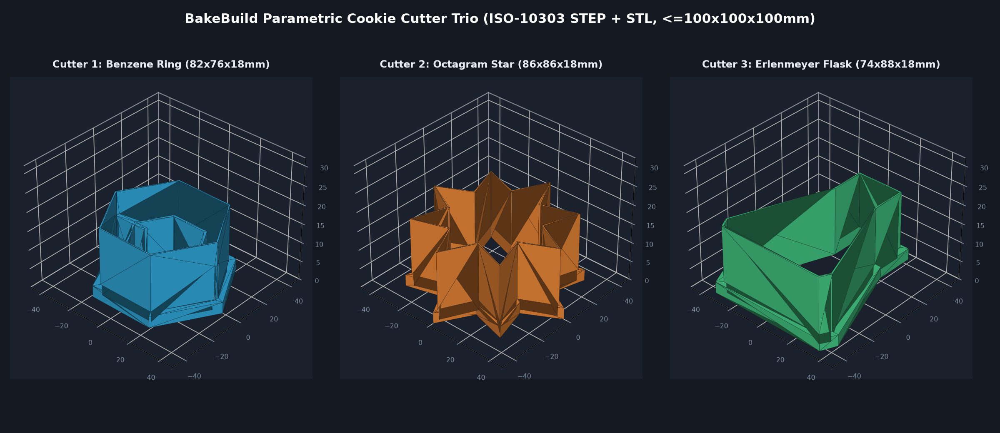

# BakeBuild Parametric Cookie Cutter Trio

Three original parametric 3D-printable cookie cutters modeled with OpenCascade (`build123d`), each within the 100x100x100mm build volume with a 3.0mm ergonomic press lip and 0.9mm tapered cutting blade.

1. `cutter_1_benzene_ring.step` (82 x 76 x 18 mm) — Hexagonal chemistry benzene ring cutter with internal bond stamp ribs.
2. `cutter_2_octagram_star.step` (86 x 86 x 18 mm) — 8-pointed compass star cookie cutter.
3. `cutter_3_erlenmeyer_flask.step` (74 x 88 x 18 mm) — Laboratory Erlenmeyer flask cookie cutter.
4. `bakebuild_3_cookie_cutters_set.step` — Combined 3-cutter assembly STEP file.

